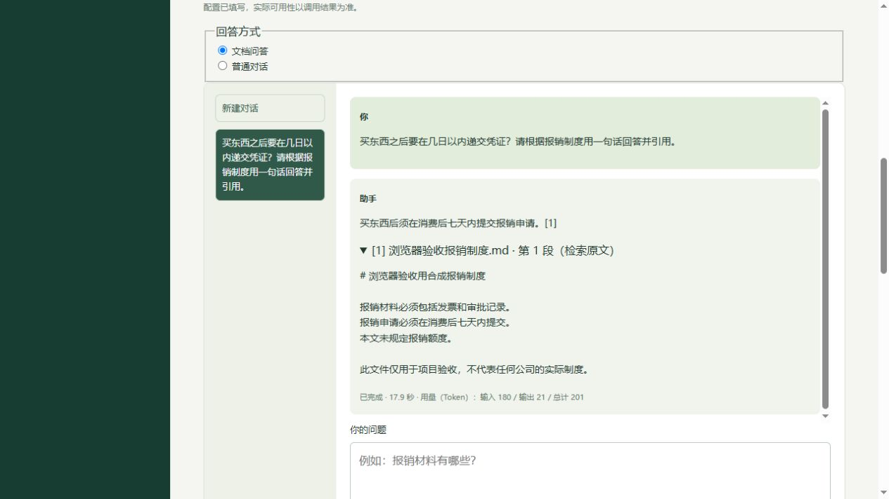
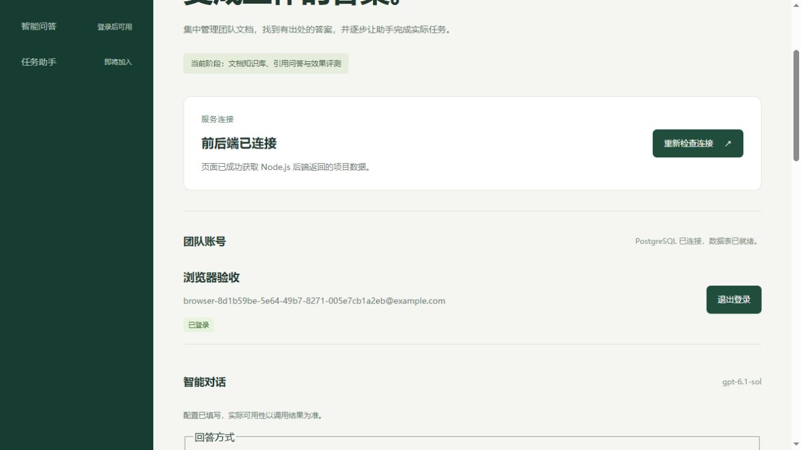

# 浏览器流程验收

2026-10-09，在 http://127.0.0.1:5173/ 使用真实浏览器、Vite 开发代理、Node.js 后端、PostgreSQL 和已配置的模型服务完成本轮验证。这一步补充自动化接口测试无法证明的页面操作。

## 实际验收结果

| 操作 | 页面实际结果 |
| --- | --- |
| 独立测试账号登录 | 登录成功，聊天与知识文档面板出现 |
| 文件选择器导入 Markdown | 自动填入文件名和内容，提示检查后保存 |
| 保存资料 | 列表出现“浏览器验收报销制度.md · 1 个片段” |
| 搜索同义问法 | “买东西之后要在几日以内递交凭证？”命中制度并展示原文 |
| 真实文档问答 | 返回消费后七天内提交的回答，并带 `[1]` |
| 展开来源 | 显示正确文件名、段号和完整原文 |
| 整页刷新 | 登录状态、历史问题、答案和来源均恢复；点击来源可再次展开 |
| 模型正文返回前停止 | 当前页面显示已停止，刷新会话和整页刷新后仍为已停止 |
| 无匹配搜索 | 显示资料不足，清除原来的搜索结果 |
| 无资料问答 | 直接拒答，显示“未调用模型” |
| 退出登录 | 聊天与知识文档隐藏，登录表单重新出现 |

真实问题为“买东西之后要在几日以内递交凭证？请根据报销制度用一句话回答并引用。”，答案为：

> 买东西后须在消费后七天内提交报销申请。[1]

引用原文写明“报销申请必须在消费后七天内提交”。页面显示 17.9 秒；用量为输入 180、输出 21、总计 201 Token。这是供应商返回的数值，没有核实其计费解释。本轮没有重跑完整固定题库的真实模式，不能把此单题成功写成新版模型准确率。



## 停止生成验证了什么

新建对话，发送“请详细列出报销材料和申请时限，每条引用资料。”，页面出现等待模型回答及来源后点击停止。界面恢复可操作，提示服务端正在保存；点击刷新会话和整页刷新后均显示已停止，正文为空，保存耗时约 0.3 秒。

这证明此路径的取消状态已保存到数据库。尚未覆盖已经收到部分文字后的停止，也没有验证断网、浏览器关闭、供应商长期超时或连续大量请求。取消请求没有返回用量，不能据此认定供应商没有收费。



## 本轮发现并修复的问题

概览与侧栏仍显示知识库待开发、问答即将加入，容易误导用户。现在后端项目状态返回知识库和对话已实现，页面阶段读取后端实际状态；侧栏提示登录后可用。侧栏仍是说明文字，本轮没有新增独立页面导航。

供应商用量中包含很长的归因和计费元数据，原页面直接显示整段 JSON，影响阅读。现在只展示可识别的输入、输出和总 Token 数，同时兼容 Responses 与 Chat 的字段；原始用量仍存于数据库。缺少标准字段时显示格式未识别，不推算费用。无资料直接拒答明确标注未调用模型。

文档问答的输入示例也改为“报销材料有哪些？”，普通对话仍使用数据库事务示例。

## 如何自行复现

先启动数据库与项目。可使用自己的测试账号，或准备本机临时验收账号：

```powershell
Set-Location D:\zhxzzz\team-knowledge-assistant
npm run build
node scripts/browser-fixture.mjs
```

脚本要求后端正在 3001 端口运行，通过注册接口创建独立测试用户。随机邮箱、密码与用户 ID 仅写入本机 `.browser-acceptance/account.json`，此目录已加入 Git 忽略。可以在本机查看后登录，不要把凭据复制到聊天或提交到仓库。已有记录时脚本会拒绝重复创建。

登录后选择 `docs/fixtures/浏览器验收报销制度.md`，保存文档；按上表搜索、提问、展开来源并刷新。真实问答会请求配置的第三方模型，可能消耗额度，取消也不保证免计费。

退出测试账号后清理：

```powershell
node scripts/browser-fixture.mjs --cleanup
```

清理按临时用户 ID 和邮箱匹配，只删除此账号及其关联会话、消息、文档和登录记录，并移除本机凭据文件。本轮已执行退出与清理；截图保留了测试时的页面状态，不表示数据库还留着这些资料。原先网页不是已登录状态，本轮结束后恢复到未登录页面。

## 回归检查与下一步

类型检查、普通接口测试 1 项、真实数据库测试 3 项及生产构建全部通过。浏览器验证不替代这些检查，截图也不能证明所有条件下都正确。

下一步加入带执行记录的任务工具，先实现明确、可确认的操作流程，再让模型选择工具。生产部署、移动端知识库交互和部分正文取消还需继续验收。
